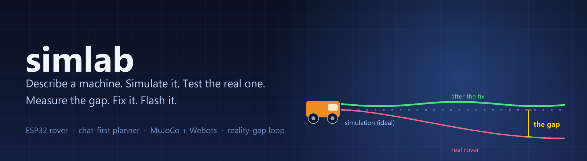
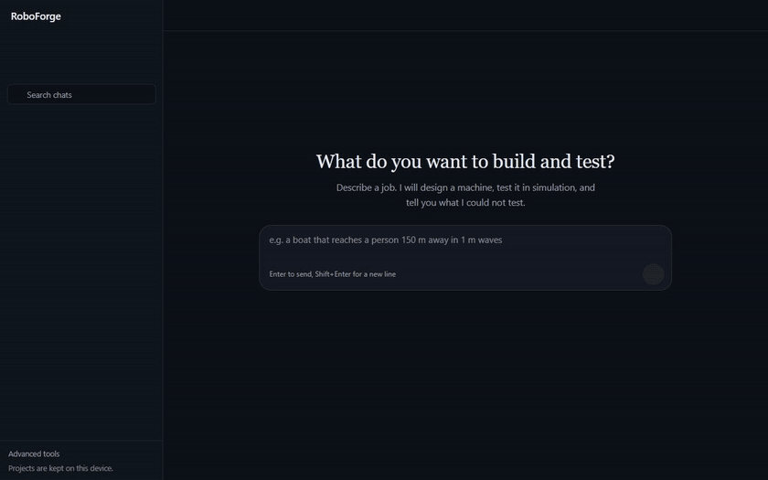
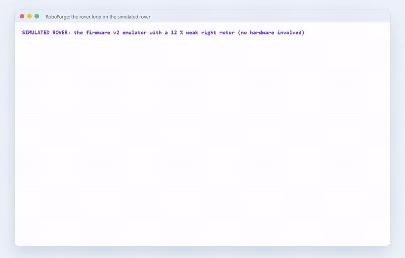
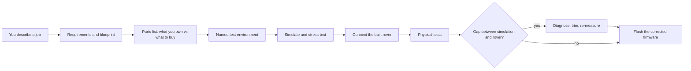

<p align="center">
  
</p>

<p align="center">
  
  
  
  
  
</p>

<p align="center">
  <b>Tell it what you want to build. It designs the machine, tests it in simulation, and then checks the real one against the simulation.</b>
</p>

<p align="center">
  <a href="#see-it-work">See it work</a> ·
  <a href="#how-it-works">How it works</a> ·
  <a href="#the-rover-loop">The rover loop</a> ·
  <a href="#quick-start-windows">Quick start</a> ·
  <a href="#whats-in-the-box">What is in the box</a>
</p>

<p align="center"><sub><b>RoboForge</b> is the project's name; the Python packages and folders keep their older names (<code>simlab/</code>, <code>sewerbot/</code>).</sub></p>

---

## See it work

**Chat to a design.** Pick an example (or describe a job): the app writes down what it understood, picks a machine from sourced parts, runs it in 3D, builds a set of tough-conditions tests, runs them all, and says what it could *not* test.

<p align="center"></p>
<p align="center"><sub>Real recording of the running app ( <a href="docs/media/chat.mp4">mp4</a> ). Waiting stretches are sped up 4×. The AI planner was switched off for this clip, so everything shown is the offline draft.</sub></p>

**Find where the real rover differs from the simulation.** The rover is driven through a few short, firmware-timed moves. A gyro measures how it turns, and the tool names the weak motor and works out the correction, then re-measures.

<p align="center"></p>
<p align="center"><sub>This clip runs on the <b>firmware v2 emulator</b> with a deliberately weak right motor, not on real hardware ( <a href="docs/media/rover-loop.mp4">mp4</a> ). Real-rover results will replace it after the first-contact run.</sub></p>

## How it works



* **Chat-first planner:** a deterministic router handles buttons and edits; an AI model (free OpenRouter tier) is used only to plan a new job, and every plan is checked by code against a closed menu ([docs/PLANNER.md](docs/PLANNER.md), [docs/CHAT_PROTOCOL.md](docs/CHAT_PROTOCOL.md)).
* **Builder:** assemble a machine from 55 sourced parts and get predicted speed, runtime and errors, with verified "add this part" suggestions ([docs/BUILDER.md](docs/BUILDER.md)).
* **Simulation:** MuJoCo for fast runs, Webots for the sewer world; control policies and camera detectors can be trained on simulator data ([docs/LAB.md](docs/LAB.md)).
* **Honest by construction:** every result carries what was *not* tested, and wording such as "safe" or "guaranteed" is banned in the app's own sentences.

## The rover loop

Real motors are never identical, so a rover that drives straight in simulation pulls to one side on the floor. The loop in `simlab/twin/` measures that and corrects it.

| Step | What happens | Where |
|---|---|---|
| First contact | finds the board, reads its firmware, checks pins, gyro, ultrasonic sensor and power; refuses a wiring that shares a pin | `tools/rover_bringup.py` |
| Measure | straight runs, spins, each wheel alone and rising duty, each repeated | `tools/rover_gap.py`, `simlab/twin/protocol.py` |
| Diagnose | weak or dead motor, backwards wheel, late-starting (humming) motor, power resets, with evidence and confidence | `simlab/twin/diagnose.py` |
| Correct | a trim that cancels the pull; the twin is fitted so the simulation matches this rover | `simlab/twin/calibrate.py` |
| Flash | compile and upload firmware only after you confirm; the Wi-Fi password never enters the repo | `tools/flash.py` |

The gyro alone gives the answer: a straight run turns at `a(gR − gL)`, a spin at `a(gR + gL)`, and one wheel alone at `∓a·g`. Three independent measurements that agree give a high-confidence trim, no speed or distance sensor needed.

<details>
<summary><b>Rover wiring (ESP32 DevKit)</b></summary>

| Function | GPIO |
|---|---|
| Left motor (DRV8833 IN1 / IN2) | 26 / 27 |
| Right motor (IN3 / IN4) | 32 / 33 |
| MPU6050 SDA / SCL (3V3, AD0 to GND) | 21 / 22 |
| HC-SR04 TRIG / ECHO (ECHO through a 10k/20k divider, VCC 5 V) | 18 / 35 |

GPIO34, 35, 36 and 39 are input-only on the ESP32, so TRIG must not be on them. The motor and I2C pins must not overlap. Details: [docs/HARDWARE.md](docs/HARDWARE.md).
</details>

**Status:** the firmware (`firmware/esp32_rover_v2`) compiles with and without Wi-Fi, and the whole loop is tested against an emulated rover with injected faults. It has **not** yet run on the physical rover; the first-contact run is the next gate.

## Quick start (Windows)

```powershell
# 1. one-time setup, see docs/SETUP.md (Python 3.11 venv, Webots R2025a, optional GPU stack)
# 2. start the app (double-click startup.bat, or:)
.venv\Scripts\python.exe -m sewerbot            # opens http://127.0.0.1:8000/chat
```

`startup.bat` does the same and, if a dashboard is already running, just opens it.

```powershell
# rover (after wiring and flashing, see docs/HARDWARE.md)
.venv\Scripts\python.exe -m tools.flash --check                      # compile only, touches no board
.venv\Scripts\python.exe -m tools.flash --port COM6 --confirm FLASH  # flash firmware v2 (wheels off the ground)
.venv\Scripts\python.exe -m tools.rover_bringup --port COM6          # first contact
.venv\Scripts\python.exe -m tools.rover_gap --port COM6              # measure the gap
```

* **`/chat`:** the chat app with sidebar and side panes (Plan, Simulation, Tests, Parts, Rover, Tasks).
* **`/` (older tabs):** Goal · Lab · Builder · Train · Sewer (Webots) · Hardware.
* **Hardware tab:** no rover yet? **Try with emulator** streams simulator frames and mimics the firmware.

<details>
<summary><b>Original Sewerbot architecture</b></summary>

```
          ┌───────────────── sewerbot (Python, runs on the laptop GPU) ──────────────────┐
          │  detectors · defect tracker · route planner · reports · dashboard            │
          └──────────────▲────────────────────────────────────────▲──────────────────────┘
     frames+pose │ (v,ω) │                                  frames │ (v,ω) via USB serial / UDP
          ┌──────┴────────┴──────┐                       ┌────────┴───────────────────────┐
          │ Webots adapter       │                       │ ESP32-CAM  (MJPEG, port 81)    │
          │ sewer world + rover  │                       │ ESP32 + DRV8833                │
          └──────────────────────┘                       └────────────────────────────────┘
```
Cracks and leaks are found by a detector (RF-DETR trained on simulator data, or a training-free OpenCV fallback), tracked into a defect map and written to a report.
</details>

## What is in the box

| Part | Where | Notes |
|---|---|---|
| Chat app | `simlab/chat/`, `simlab/dashboard/static/chat*` | intents, cards, test cases, budget counter, live 3D view |
| Reality-gap engine | `simlab/twin/` | protocol, diagnosis, twin calibration |
| Rover firmware | `firmware/esp32_rover_v2/` | soft start, gyro heading-hold, settings in flash, optional Wi-Fi; `esp32_rover_serial` is the recovery build |
| Hardware layer | `sewerbot/hardware/` | serial client, bring-up checks, flash tool, pin map, firmware emulator |
| Bag/box missions | `simlab/missions/`, `simlab/tasks/bag_mission.py` | follow, orbit, bag to bag, stop at a goal; targets learned from photos (simulator only so far) |
| Project store | `simlab/project/` | requirements, equipment, sensor status, named environment |
| Sewer maps (YAML) | `maps/` | pipes (round / oval / box), chambers, branches, goal posts, planted or random cracks and leaks |
| World generator | `tools/gen_world.py` | YAML + rover profile to a Webots world |
| Rover model | `sim/webots/protos/SewerRover.proto` | 2-wheel, 4-wheel, 6-wheel, tracked |
| Detectors | `sewerbot/brain/detectors/` | `rfdetr` (Apache-2.0), `classical` (no training), optional `yolo` (AGPL) |
| Builder | `simlab/parts/` | derived speed, thrust and runtime; rules; calibration |
| Tests | `tests/` | `pytest -q`: 900+ tests (Webots and hardware are not needed) |

Results at a glance (simulator data): RF-DETR Nano on 450 unseen images found cracks at 92 % precision / 85 % recall and leaks at 93 % / 86 %, 28 ms per frame; a 5-goal mission found 16 of 16 planted defects. Details: [docs/RESULTS.md](docs/RESULTS.md).

Licensing summary: [docs/LICENSING.md](docs/LICENSING.md). Re-record the clips with `tools/record_demo.py`; the banner is drawn by `tools/make_banner.py`.
